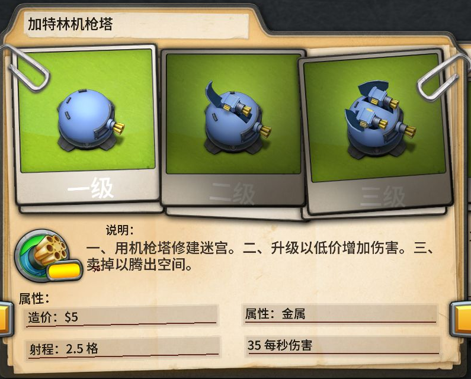
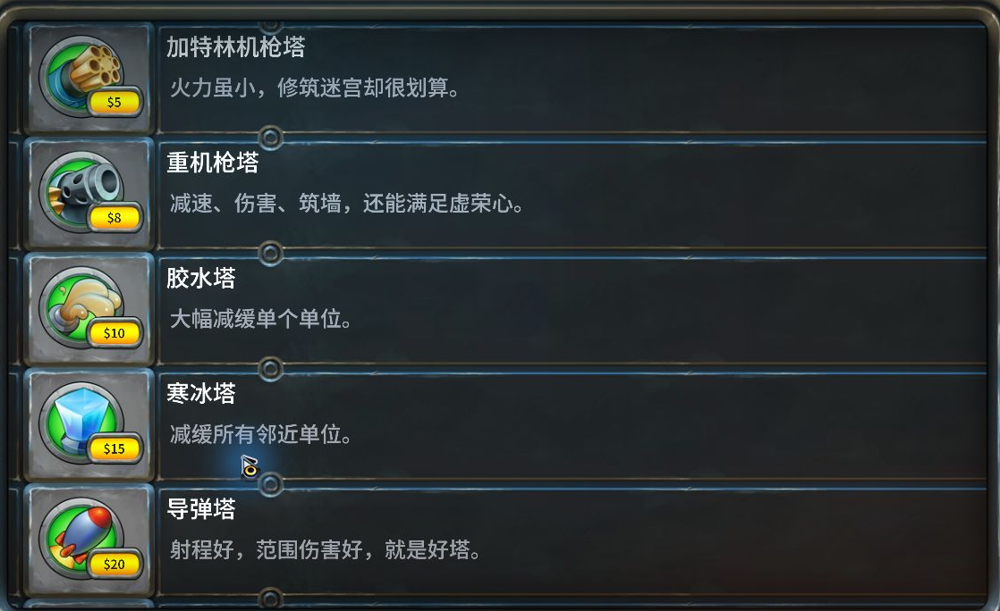

# Fieldrunners 2 简体中文补丁

《坚守阵地 2》Steam Windows 版的非官方简体中文补丁。当前版本 **v0.1.0，公开测试版**。

[下载补丁](https://github.com/tfz96/fieldrunners2-zh/releases/tag/v0.1.0) · [反馈问题](https://github.com/tfz96/fieldrunners2-zh/issues)

## 安装

1. 关闭游戏，下载发行页中的 `Fieldrunners2-ZH-v0.1.0-Windows.zip` 并解压。
2. 双击 `Fieldrunners2-ZH-v0.1.0.exe`。安装器会尝试查找 Steam 游戏目录，也可以手动选择包含 `Fieldrunners2.exe` 的文件夹。
3. 点击“安装 / 更新汉化”，等待校验通过，再**从 Steam 启动游戏**。

安装器适用于 Windows 10 / 11 x64，不需要另装 Python。构建资源包时需要约 2 GB 可用内存，以及至少 1 GB 可用磁盘空间。原游戏仍为 32 位程序。

安装器只处理 `Data.pak` 与 `Fieldrunners2.dll`，会在游戏目录保留经过 SHA-256 校验的 `.fr2zh-original` 备份和 `fr2zh-install.json` 安装记录。**请保留这些文件，勿覆盖原版备份。** 不处理存档、Steam 客户端或 Steam API。

## 还原

关闭游戏，重新打开安装器，选择同一个游戏文件夹，点击“还原原版”。还原后备份继续保留，可再次安装汉化。“校验文件”可检查当前汉化及原版备份。

若安装被中断，可再次打开安装器执行还原。发现其他补丁或未知版本时，安装器会停止，避免覆盖已有修改。Steam 验证游戏完整性也可以恢复官方文件。

## 适用版本

- Steam AppID：`215710`
- 已验证 Windows build：`37185`
- 原版 `Data.pak` SHA-256：`ea2c3de3636124feba025a9c437a5dd0b3e97815c811203dfbef2088b80f8c49`
- 原版 `Fieldrunners2.dll` SHA-256：`8a2a552c4c1dd316cfe3dd50f06aa6b5681ac6e9d5299c1c8c034ff39fec9517`

两个文件的哈希都必须匹配。未来 Steam 更新、其他渠道版本及已修改客户端需要另行适配。

## 内容与验证范围

- 987 条通用文本记录、24 条桌面专用记录，包含菜单、关卡、教程、敌军、防御塔、道具、卡牌及成就说明；原本为空的两条说明仍为空。
- 翻译界面中直接写死的文本，以及 DLL 中两处卡组显示文字。
- 内置 Noto Sans SC 衍生的静态 TrueType 中文字体子集。
- 修复游戏原生 TrueType 分支的居中、字符换行、文本缩放和金币 / 星星符号显示。
- 仅在显示时转换旧存档缓存的英文关卡名与说明，不改写存档。
- 版本检查、备份校验、原子文件替换、异常回滚、还原及重复安装测试。

已在真实 Steam 客户端检查主菜单、设置、地图、难度选择、出战准备、图鉴长说明及已有任务的战斗界面加载。12 项自动测试还覆盖真实原版资源包的全部文本和未修改资源字节，详见[验证记录](docs/VALIDATION.md)。

这是首次公开测试，**尚未逐关通关验证**。图片中绘制的英文、游戏标题贴图、配音和 Steam 平台自身的成就名称不在本版修改范围内。个别原版逐字动画和位图字体特效与英文版可能不同。遇到截字、排版或译文问题，请附上关卡和界面截图反馈。





## 从源码运行

需要 Python 3.10 或更高版本；普通安装和还原只使用标准库，不需要开发依赖。

```powershell
python patcher.py
python patcher.py --game-dir "F:\SteamLibrary\steamapps\common\Fieldrunners 2" install
python patcher.py --game-dir "F:\SteamLibrary\steamapps\common\Fieldrunners 2" verify
python patcher.py --game-dir "F:\SteamLibrary\steamapps\common\Fieldrunners 2" restore
```

开发、测试及重新构建参见 [开发说明](docs/DEVELOPMENT.md)。仓库与发行包仅包含译文、开放字体、补丁逻辑和自行编写的兼容代码；**不含原游戏资源包、原版 DLL、可执行文件或存档**。用户须自行拥有游戏。

## 授权

补丁代码与自编译文按 [MIT License](LICENSE) 发布。字体及其度量数据遵循 [SIL Open Font License 1.1](assets/OFL.txt)，来源与处理方式见 [字体说明](assets/FONT-NOTICE.md)。游戏、美术与商标归 Subatomic Studios 等相应权利人所有。本项目与游戏开发商、发行商及 Valve 无关联。
