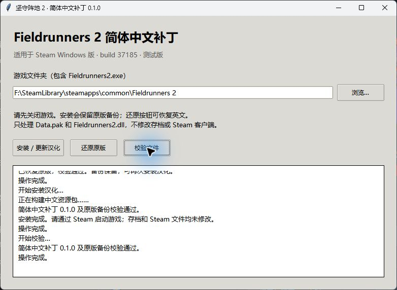

# v0.1.0 验证记录

测试环境：Windows x64、Steam AppID 215710 / build 37185。以下是本次实际执行的检查，不代表逐关完整通关。

- `pnpm lint`：通过。
- `FR2_GAME` 指向受支持的本地游戏后执行 `pnpm test`：12 项通过，含仅读取原版备份的真实资源集成检查。
- 最终独立 EXE：自动检测游戏目录，执行还原、重新安装、校验，均成功。
- 还原后的 `Data.pak`、`Fieldrunners2.dll` SHA-256 与 README 的原版值完全一致。
- 安装后校验当前文件及原版备份；重复安装、损坏备份、未知版本、外部修改、模拟写入失败与安装中断恢复另有自动测试覆盖。
- 通过 Steam 启动：已检查主菜单、设置、地图、难度选择、出战准备、防御塔与敌军图鉴，以及已有任务的战斗界面加载。
- 检查中文字体、长说明换行、居中、金币与星星替代符号；旧存档缓存的关卡名和说明使用显示时转换。

尚未验证所有关卡、全部卡牌触发和所有分辨率。图片内英文、配音及 Steam 平台自身文案不在此版本范围内。测试存档不随项目发布。

